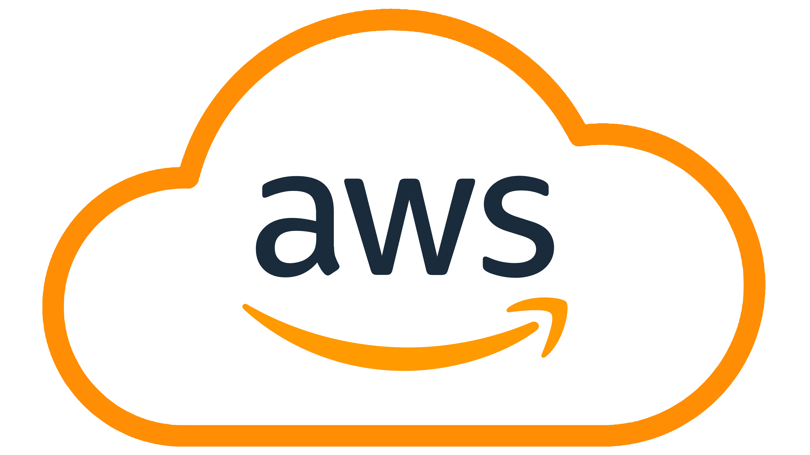

# AWS Fundamentals

## Topics

- **EC2** - virtual servers: launching, SSH access, security groups
- **S3** - object storage: buckets, permissions, static hosting
- **IAM** - users, roles, policies. The most important, most misunderstood service - spend real time here.
- **VPC** - subnets (public/private), route tables
- **AWS CLI** - doing from the terminal what you'd otherwise click through in the console
- **Load Balancers** (ALB/ELB) - distributing traffic across instances

## How to learn

- [AWS Skill Builder](https://skillbuilder.aws/) - free, official, structured learning paths.
- Optional certification: **AWS Certified Cloud Practitioner (CLF-C02)**.

## How to practice

Use the [AWS Free Tier](https://aws.amazon.com/free/) (real account, real limits). Do each action through the console first, then repeat it with the AWS CLI, then automate one or two with [boto3](https://boto3.amazonaws.com/v1/documentation/api/latest/index.html) (AWS Python SDK).

## Resources

- [AWS Skill Builder](https://skillbuilder.aws/)
- [AWS Free Tier](https://aws.amazon.com/free/)
- [AWS CLI Documentation](https://docs.aws.amazon.com/cli/)
- [Boto3 Documentation](https://boto3.amazonaws.com/v1/documentation/api/latest/index.html)
- [AWS Certified Cloud Practitioner](https://aws.amazon.com/certification/certified-cloud-practitioner/)
