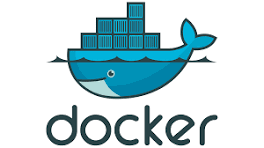

# Docker & Containers

## Topics

- Containers vs virtual machines (concept)
- Dockerfile basics: `FROM`, `COPY`, `RUN`, `CMD`, `EXPOSE`
- Images vs containers: `build`, `run`, `ps`, `logs`, `exec`
- Docker Compose for multi-container apps
- Volumes and Docker networking basics
- Multi-stage builds - keeping images small
- `HEALTHCHECK` - how Docker tells if a container is actually working
- Pushing an image to Docker Hub
- `.dockerignore`

## How to learn

- [Docker Get Started](https://docs.docker.com/get-started/) - Docker's own guide.
- [docker-curriculum.com](https://docker-curriculum.com/) - free, project-based walkthrough.

## How to practice

Containerize every project you've already built. If it runs on your machine, it should also run in a container.

## Resources

- [Docker Get Started](https://docs.docker.com/get-started/)
- [Docker Compose Overview](https://docs.docker.com/compose/)
- [docker-curriculum.com](https://docker-curriculum.com/)
- [Play with Docker](https://labs.play-with-docker.com/)
