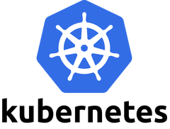

# Kubernetes I - Fundamentals

!!! note "Prerequisite"
    Solid Docker fundamentals - don't start this without them.

## Topics

- Architecture: control plane, nodes, pods, kubelet, etcd (conceptual)
- Core objects: Pods, Deployments, Services, ConfigMaps, Secrets
- Labels and selectors - how a Service finds the right Pods
- Readiness and liveness probes - how Kubernetes knows a pod is healthy
- Rolling updates and rollbacks - how a Deployment updates Pods without downtime
- Writing and reading YAML manifests
- Core `kubectl` commands: `get`, `describe`, `logs`, `exec`, `apply`

## How to learn

- [Kubernetes Docs - Tutorials](https://kubernetes.io/docs/tutorials/) - official, free, interactive.
- [KodeKloud - Free Kubernetes Course](https://kodekloud.com/courses/kubernetes-for-the-absolute-beginners-hands-on/) - browser-based labs, no local cluster setup required to start.

## How to practice

Run a local cluster daily using [minikube](https://minikube.sigs.k8s.io/docs/) or [kind](https://kind.sigs.k8s.io/). Deploy something, break it on purpose, then fix it by reading `kubectl describe` and `kubectl logs`.

## Resources

- [Kubernetes Docs](https://kubernetes.io/docs/home/)
- [KodeKloud Free Courses](https://kodekloud.com/courses/)
- [minikube](https://minikube.sigs.k8s.io/docs/)
- [kind](https://kind.sigs.k8s.io/)
